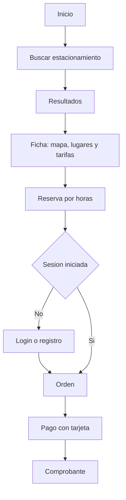
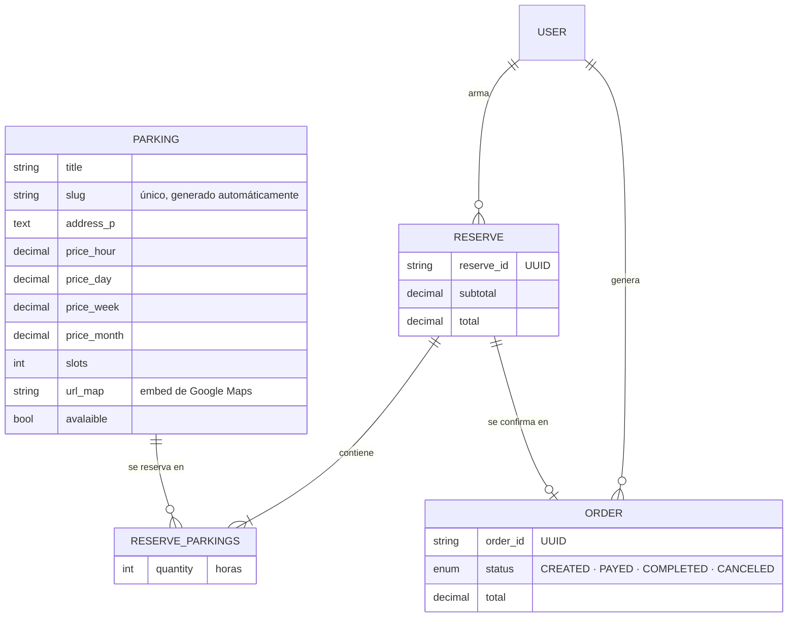

# Epark

### Estacionar ya no es problema.

Epark es una plataforma web para **buscar y reservar estacionamientos privados por hora**. El conductor encuentra un lugar por nombre o en el mapa, arma su reserva, paga y recibe un comprobante. Los estacionamientos se publican con su ubicación en Google Maps, su capacidad y sus tarifas.

**Demo en producción:** [epark.pythonanywhere.com](https://epark.pythonanywhere.com/)

`Python` · `Django 3.2` · `MySQL` · `Bootstrap 5` · `Google Maps` · `PythonAnywhere`

---

## El problema

Encontrar dónde dejar el auto en una ciudad grande suele implicar dar vueltas sin saber si habrá lugar ni cuánto va a costar. Los estacionamientos privados, por su parte, no siempre tienen un canal digital para mostrar su disponibilidad y sus precios.

## La solución

Un sitio que reúne la oferta de estacionamientos en un solo lugar y permite reservar antes de salir. Cada estacionamiento tiene su ficha con dirección, mapa, cantidad de lugares y tarifas por hora, día, semana y mes. El usuario elige cuántas horas necesita, revisa el total y confirma.

---

## Recorrido del usuario

Versión en texto

1. **Inicio:** el usuario busca un estacionamiento por nombre o elige uno de los más buscados.
2. **Ficha:** ve la dirección en el mapa, la cantidad de lugares y las tarifas.
3. **Reserva:** indica cuántas horas necesita; puede sumar o quitar estacionamientos.
4. **Sesión:** si no inició sesión, se le pide login o registro.
5. **Orden:** se genera la orden con el total.
6. **Pago:** completa los datos de la tarjeta.
7. **Comprobante:** recibe la confirmación con el detalle y el total.

Un detalle de diseño: **la reserva existe antes del login**. Un visitante anónimo puede armar su reserva; cuando inicia sesión, la reserva guardada en su sesión se le asigna automáticamente y la orden se crea recién en ese momento.

---

## Arquitectura

El proyecto está dividido en cuatro aplicaciones Django con responsabilidades separadas, más el módulo principal que concentra la portada, la autenticación y el contacto.

| App | Responsabilidad |
|---|---|
| `epark` | Configuración, portada, login, registro, logout y contacto |
| `users` | Modelo de usuario personalizado (`AbstractUser`) y proxy `Customer` |
| `parking` | Catálogo de estacionamientos, búsqueda y ficha de detalle |
| `reserves` | Reserva en curso: agregar, quitar y recalcular totales |
| `orders` | Orden de compra, estados, pago y confirmación |

### Modelo de datos

---

## Decisiones técnicas

**Totales que se mantienen solos.** Los importes de la reserva no se calculan en las vistas: se recalculan mediante *signals* de Django (`post_save` sobre el detalle y `m2m_changed` sobre la relación) cada vez que se agrega, modifica o quita un estacionamiento. Si la reserva ya tiene una orden asociada, también se actualiza el total de la orden.

**Relación muchos a muchos con datos propios.** La reserva y los estacionamientos se vinculan a través de un modelo intermedio (`ReserveParkings`) que guarda las horas reservadas. Un *manager* personalizado resuelve en una sola operación el caso de agregar un estacionamiento nuevo o sumar horas a uno existente.

**Consultas optimizadas.** El cálculo del subtotal usa `select_related` para traer cada detalle junto con su estacionamiento en una única consulta.

**Identificadores y URLs limpias.** Las reservas y órdenes reciben un UUID mediante `pre_save`. Cada estacionamiento obtiene un *slug* a partir de su nombre, con sufijo aleatorio si el nombre ya existe, lo que da URLs legibles como `/parking/garage-mexico`.

**Vistas basadas en clases.** El listado, la búsqueda y la ficha usan `ListView` y `DetailView`; la búsqueda filtra por nombre sin distinguir mayúsculas y devuelve la cantidad de resultados.

**Usuario personalizado desde el inicio.** `AUTH_USER_MODEL` apunta a un modelo propio basado en `AbstractUser`, lo que permite extender el usuario sin migraciones dolorosas más adelante.

**Seguridad de acceso.** La orden, el pago y la confirmación están protegidos con `@login_required`, y el login respeta el parámetro `next` para devolver al usuario a donde estaba. El registro valida que el correo no exista y que las contraseñas coincidan.

**Presentación.** Filtros de plantilla propios para formatear precios y pluralizar las horas ("1 hora agregada", "3 horas agregadas"), mensajes flash para feedback y un *breadcrumb* que guía el proceso de compra.

---

## Despliegue

El sitio corre en **PythonAnywhere** con una base de datos **MySQL** administrada por la plataforma y archivos estáticos servidos con **WhiteNoise**. Los estacionamientos, con su imagen, ciudad, tarifas y mapa, se cargan desde el panel de administración de Django.

El proyecto pasó antes por un intento de despliegue en Vercel con PostgreSQL, que se reemplazó por PythonAnywhere por su soporte nativo para aplicaciones Django con base de datos persistente.

---

## Estado y próximos pasos

El flujo de búsqueda, reserva, orden y comprobante está completo. Algunas piezas quedan como base para seguir creciendo:

- **Pago.** El formulario de tarjeta es una interfaz demostrativa; el siguiente paso es integrar una pasarela real como Mercado Pago o Stripe y actualizar el estado de la orden según la respuesta.
- **Propietarios.** El registro y login de dueños de estacionamientos está iniciado; falta que el alta cree el estacionamiento y le dé al propietario un panel propio en lugar de depender del administrador.
- **Tarifas.** El modelo ya guarda precios por día, semana y mes; hoy el cálculo de la reserva usa la tarifa por hora.
- **Disponibilidad.** Descontar lugares ocupados según las reservas confirmadas para mostrar disponibilidad real.

---

## Autor

**Gastón Paez** · Desarrollador Backend Python
[LinkedIn](https://www.linkedin.com/in/gp-dev) · [GitHub](https://github.com/GastonPaez) · [Portfolio](https://gastonpaez.github.io/portfolio_web/)
